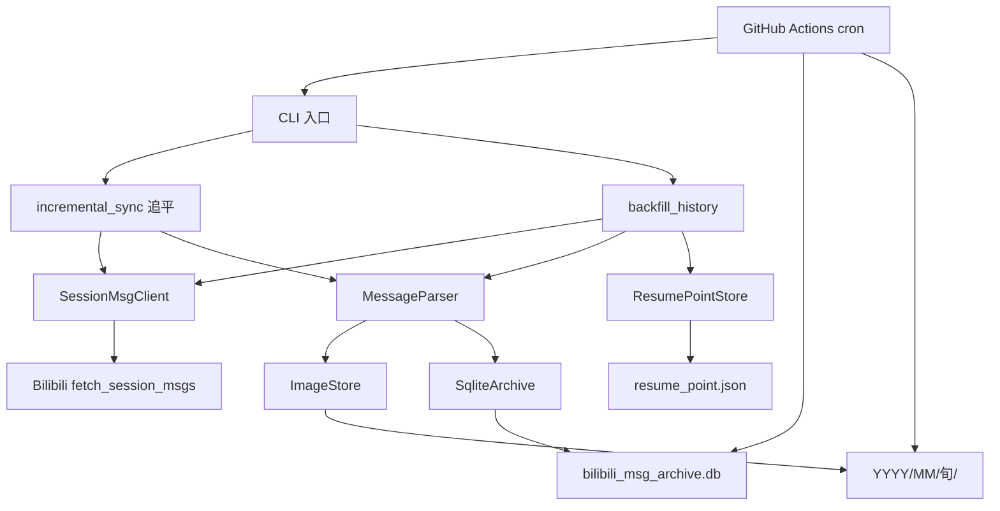
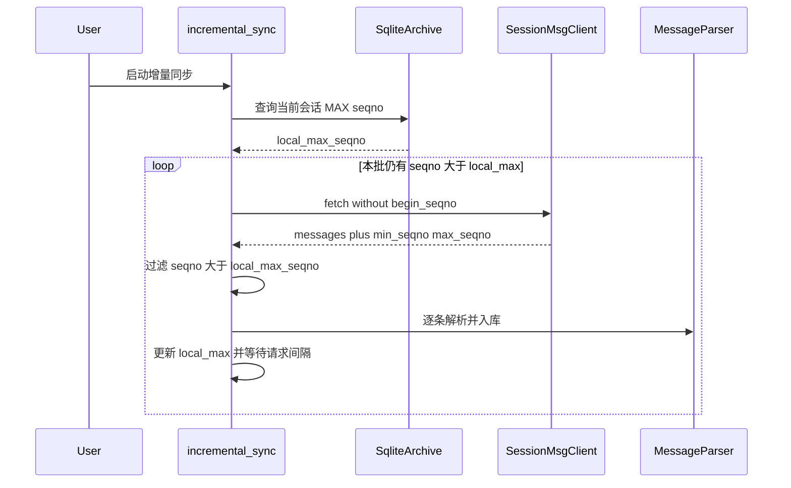
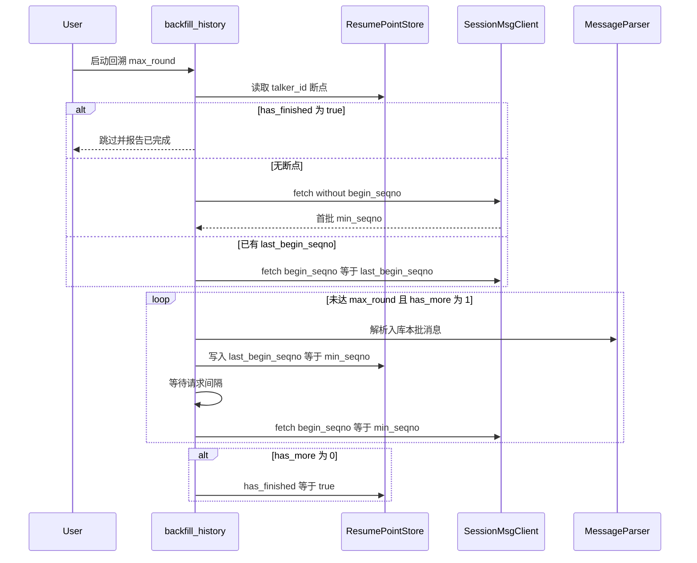

# B 站私信单会话本地归档工具

Feature Name: first
Updated: 2026-11-07

## Description

本方案实现一个面向个人学习测试的归档工具：通过 B 站 `fetch_session_msgs` 拉取指定会话私信，元数据写入仓库内 SQLite，图片按 `年/月/旬` 写入仓库。v1 只记录，不实现查阅。

设计目标：

1. 增量同步循环追平本地最大 seqno 之后的全部新消息。
2. 回溯补历史低频、分批、可断点续跑。
3. 两条流程互相独立，共享存储与解析层。
4. GitHub Actions 每日跑增量，把 db / 图片 / 断点提交回仓库。
5. 本仓库无旧存档，图片路径采用新分层：`{YYYY}/{MM}/{01-10|11-20|21-月末}/{seqno}.ext`。

技术选型：Python 3.11+，`sqlite3` + `urllib`。CLI 仅 `sync` / `backfill` / `status`。

## Architecture

系统分为五层：入口、同步编排、接口客户端、解析、存储。增量同步与回溯补历史只在编排层分叉，下层全部复用。



增量同步数据流：



回溯补历史数据流：



目录布局：

```text
.
├── README.md
├── requirements.txt
├── config.example.json
├── src/
│   ├── __init__.py
│   ├── cli.py
│   ├── config.py
│   ├── models.py
│   ├── api_client.py
│   ├── parser.py
│   ├── storage.py
│   ├── image_store.py
│   ├── resume.py
│   ├── sync_incremental.py
│   └── sync_backfill.py
├── tests/
│   ├── test_parser.py
│   ├── test_image_store.py
│   ├── test_storage.py
│   ├── test_resume.py
│   ├── test_sync_incremental.py
│   └── test_sync_backfill.py
├── .github/workflows/archive.yml
├── bilibili_msg_archive.db
├── resume_point.json
└── {YYYY}/{MM}/{01-10|11-20|21-月末}/
```

## Components and Interfaces

### 1. CLI (`src/cli.py`)

命令：

| 命令 | 作用 | 读写 resume_point.json |
|------|------|------------------------|
| `sync` | 增量追平 | 否 |
| `backfill` | 回溯补历史 | 是 |
| `status` | 打印本地最大 seqno、消息总数、断点状态 | 只读 |

`sync` 与 `backfill` 作为两个独立子命令，进程内不同时调用。v1 不实现 `read`。GitHub Actions 每日调度 `sync`。

### 2. Config (`src/config.py`)

从 `config.json` 或环境变量加载，字段：

| 字段 | 类型 | 默认 | 说明 |
|------|------|------|------|
| `sessdata` | string | 无，必填 | B 站 Cookie SESSDATA |
| `talker_id` | int | 无，必填 | 会话对象 ID |
| `session_type` | int | 1 | 1 用户 / 2 粉丝团 |
| `size` | int | 20 | 单次拉取条数，上限 200 |
| `request_interval_sec` | float | 1.5 | 请求最短间隔 |
| `max_round` | int | 10 | 回溯本轮最大批次数 |
| `archive_dir` | string | 仓库根 `.` | db、断点、图片均相对仓库根 |
| `retry_times` | int | 3 | 单次请求网络失败重试次数 |
| `user_agent` | string | 桌面浏览器 UA | 请求头 |

`SESSDATA` 仅来自使用者本地配置，程序不扫描、不硬编码任何平台环境中的 LLM 或账号密钥。

### 3. SessionMsgClient (`src/api_client.py`)

封装唯一外部接口：

```
GET https://api.vc.bilibili.com/svr_sync/v1/svr_sync/fetch_session_msgs
```

请求参数：`talker_id`、`session_type`、`size`、可选 `begin_seqno`、`build=0`、`mobi_app=web`。

Cookie：`SESSDATA=<value>`。

返回映射为内部结构：

```python
@dataclass
class FetchResult:
    messages: list[RawMessage]
    has_more: int
    min_seqno: int
    max_seqno: int
```

客户端职责：

- 每次请求前等待 `request_interval_sec`（进程内上次请求时间戳）。
- 将 `code=-101` 映射为 `AuthExpiredError`。
- 将 HTTP 412 映射为 `RateLimitedError`。
- 将其他非 0 `code` 映射为 `ApiError`。
- 网络异常按 `retry_times` 退避重试。

客户端不感知增量 / 回溯差异，不读写存储。

### 4. MessageParser (`src/parser.py`)

输入一条接口消息，输出待入库记录 + 可选图片下载任务。

| msg_type | content_text | image_local_path | raw_content |
|----------|--------------|------------------|-------------|
| 1 | JSON.`content` | NULL | 原始 content 字符串 |
| 2 | NULL | 下载成功则为相对路径，失败为 NULL | 原始 content 字符串 |
| 其他 | NULL | NULL | 原始 content 字符串 |

`msg_status=1` 的撤回消息走同一解析路径，内容照常保留。

图片下载失败只记录日志，消息仍入库。解析层调用 `ImageStore.save()`，失败时返回 `None`。

接口字段 `msg_seqno` 映射为存档主键 `seqno`。`seqno` 使用 Python `int`，避免大整数精度丢失。

### 5. SqliteArchive (`src/storage.py`)

建表 SQL（固化，禁止改列）：

```sql
CREATE TABLE IF NOT EXISTS private_messages (
    seqno INTEGER PRIMARY KEY,
    talker_id INTEGER NOT NULL,
    sender_uid INTEGER NOT NULL,
    timestamp INTEGER NOT NULL,
    msg_type INTEGER NOT NULL,
    msg_status INTEGER NOT NULL,
    content_text TEXT,
    raw_content TEXT,
    image_local_path TEXT,
    created_at INTEGER NOT NULL
);

CREATE INDEX IF NOT EXISTS idx_private_messages_talker_seqno
    ON private_messages(talker_id, seqno);
```

接口：

- `get_max_seqno(talker_id) -> int | None`
- `exists(seqno) -> bool`
- `insert_if_absent(row) -> bool`：已存在则返回 False 并跳过
- `list_by_talker(talker_id, limit, after_seqno) -> list[Row]`：`ORDER BY seqno ASC`
- `count(talker_id) -> int`

插入使用 `INSERT OR IGNORE`，与入库前 `seqno` 存在性判断双保险。WAL 模式开启，便于 10 万级写入。

### 6. ImageStore (`src/image_store.py`)

桶算法（UTC 日历，按日归属旬，不跨月）：

```text
date = UTC(timestamp)
year, month, day = date.year, date.month, date.day
last_day = days_in_month(year, month)
if day <= 10:
    span = "01-10"
elif day <= 20:
    span = "11-20"
else:
    span = "21-" + f"{last_day:02d}"
relative_path = f"{year}/{month:02d}/{span}/{seqno}{extension}"
```

示例：`2025/02/01-10/123.jpg`、`2026/12/21-31/456.jpg`。2 月非闰年下旬为 `21-28`。日落入哪一旬按日历日，不做跨月四舍五入。

扩展名从 URL 或 `imageType` 推断，缺省 `.jpg`。下载带 `Referer: https://message.bilibili.com/`。文件已存在则跳过。

### 7. ResumePointStore (`src/resume.py`)

仅回溯流程使用。文件 `resume_point.json`：

```json
{
  "123456": {
    "last_begin_seqno": 308188515844097,
    "has_finished": false
  }
}
```

- key 必须是字符串形式的 `talker_id`。
- 每批处理完成后先入库再写断点，写断点使用临时文件 + `os.replace` 保证原子替换。
- 增量同步模块禁止 import 本组件。

### 8. incremental_sync (`src/sync_incremental.py`)

```text
anchor = db.get_max_seqno(talker_id) or 0
begin = None
loop:
    result = client.fetch(..., begin_seqno=begin)
    newer = [m for m in result.messages if m.seqno > anchor]
    if newer 为空: break
    persist newer
    if anchor == 0: break          # 空库只收最新一批，历史交给 backfill
    if result.min_seqno <= anchor: break
    begin = result.min_seqno       # 倒序向前直到与本地重叠
```

空库只收最新一批。已有本地数据时，从最新批沿 `begin_seqno=min_seqno` 向前追到与 `anchor` 重叠，填上空洞。不读写 `resume_point.json`，不调用回溯。

### 9. backfill_history (`src/sync_backfill.py`)

```text
point = resume.get(talker_id)
if point.has_finished:
    return finished
begin = point.last_begin_seqno   # 可能为 None
rounds = 0
while rounds < max_round:
    result = client.fetch(..., begin_seqno=begin)
    persist all messages in result
    begin = result.min_seqno
    resume.save(talker_id, last_begin_seqno=begin, has_finished=result.has_more==0)
    rounds += 1
    if result.has_more == 0:
        break
```

首轮无断点时 `begin_seqno` 省略，用返回的 `min_seqno` 作为后续起点。

### 10. GitHub Actions (`.github/workflows/archive.yml`)

- cron：每天 UTC 16:00（北京时间 00:00）。
- `workflow_dispatch`：可选 `job=sync|backfill` 与 `max_round`。
- 步骤：checkout → Python 3.11 → `pip install -r requirements.txt` → 用 Secrets 注入 `BILI_SESSDATA`、`BILI_TALKER_ID` → `python -m src.cli sync` → 若有变更则 commit + push。
- 提交文件：`bilibili_msg_archive.db`、`resume_point.json`（仅 backfill 会改）、`YYYY/**` 图片。
- `SESSDATA` 只进 Secrets，不进仓库。
- 默认每日只跑增量；回溯走手动触发，避免一次 Actions 打满风控。

v1 不实现查阅、导出、代理、图片失败重试队列、多会话管理。

## Data Models

### 接口原始消息

| 字段 | 来源 | 说明 |
|------|------|------|
| seqno | `msg_seqno` | 唯一递增序列号 |
| sender_uid | `sender_uid` | 发送者 mid |
| timestamp | `timestamp` | 秒级时间戳 |
| msg_type | `msg_type` | 1 文本 / 2 图片 / 其他 |
| msg_status | `msg_status` | 0 正常 / 1 撤回 |
| content | `content` | JSON 序列化字符串 |

### 入库行 `private_messages`

| 字段 | 类型 | 约束 |
|------|------|------|
| seqno | INTEGER | PRIMARY KEY |
| talker_id | INTEGER | NOT NULL |
| sender_uid | INTEGER | NOT NULL |
| timestamp | INTEGER | NOT NULL，允许重复 |
| msg_type | INTEGER | NOT NULL |
| msg_status | INTEGER | NOT NULL |
| content_text | TEXT | 可为 NULL |
| raw_content | TEXT | 原始 content |
| image_local_path | TEXT | 相对路径，可为 NULL |
| created_at | INTEGER | 入库 Unix 秒 |

### 断点 `resume_point.json`

```text
Record = {
  last_begin_seqno: int | null,
  has_finished: bool
}
File = dict[str, Record]   # key = str(talker_id)
```

### 完整存档备份集合

必须同时备份：

1. `bilibili_msg_archive.db`
2. `{YYYY}/{MM}/{旬}/` 图片树
3. `resume_point.json`

缺任一文件即视为不完整备份。

## Correctness Properties

1. **主键唯一**: 任意时刻 `private_messages.seqno` 全局唯一；重复 `seqno` 被跳过，表内行数不增加。
2. **增量独立性**: `incremental_sync` 执行路径不打开、不读取、不写入 `resume_point.json`。
3. **回溯断点单调**: 同一 `talker_id` 的 `last_begin_seqno` 随成功批次递减或保持（接口倒序向前）；`has_finished=true` 之后回溯不再发请求。
4. **倒序分页语义**: 不传 `begin_seqno` 得到最新一批；传入 `begin_seqno=min_seqno` 得到更早一批，且不含该 `begin_seqno` 自身。
5. **时序查询**: 聊天先后顺序的唯一合法 SQL 为 `ORDER BY seqno ASC`；`timestamp` 不用于去重或唯一排序。
6. **图片路径稳定**: 同一 `(timestamp, seqno, ext)` 永远映射到 `{YYYY}/{MM}/{01-10|11-20|21-月末}/{seqno}.ext`。
7. **图片失败不丢消息**: 下载失败时该行仍插入，`image_local_path` 为 NULL，`raw_content` 完整。
8. **节流**: 同一进程内两次 `fetch_session_msgs` 的间隔大于等于 `request_interval_sec`。
9. **凭证失效可观测**: `code=-101` 使当前流程以非 0 退出码结束，并明确提示更新 SESSDATA。
10. **规模**: 表与 `talker_id+seqno` 索引支持 10 万行以上的去重判断与顺序分页查询。

## Error Handling

| 场景 | 检测 | 处理 |
|------|------|------|
| SESSDATA 过期 | `code=-101` | 立即停止当前命令，退出码 2，提示更新凭证；已写入数据与断点保留 |
| 风控 412 | HTTP 412 | 立即停止，退出码 3，保留数据与断点；提示加大间隔后重试 |
| 非法参数 | `code=2` 或 `-400` | 停止并打印请求参数，退出码 4 |
| 网络超时 / 连接失败 | 异常 | 指数退避重试 `retry_times` 次，耗尽后停止并保留断点 |
| `messages` 为 null 或空 | 成功响应 | 增量视为无新消息；回溯若同时 `has_more=0` 则标记完成 |
| 图片 URL 失效或防盗链 | 下载非 200 或空体 | 记日志，消息照常入库，`image_local_path` 为空 |
| content JSON 无法解析 | `json.loads` 失败 | `content_text` 为空，`raw_content` 保存原始字符串，消息入库 |
| 断点文件损坏 | JSON 解析失败 | 回溯拒绝启动并提示备份后修复，避免覆盖 |
| 数据库锁 | sqlite busy | 等待 busy_timeout=5000ms 后重试 |

日志输出到 stderr，格式：`ISO8601 level module message`。本版本不做日志持久化文件。

## Test Strategy

测试默认不打真实 B 站接口。`SessionMsgClient` 在单测中用夹具替换。

### 单元测试

| 模块 | 覆盖点 |
|------|--------|
| parser | msg_type=1 提取文本；msg_type=2 提取 url；其他类型 raw 保留；非法 JSON 降级；msg_status=1 仍解析 |
| image_store | 旬边界：1、10、11、20、21、月末；2 月 28/29；相对路径格式；已存在文件跳过 |
| storage | seqno 重复跳过；`ORDER BY seqno ASC`；timestamp 相同两条仍按 seqno 排序；MAX(seqno) |
| resume | key 为字符串 talker_id；原子写入；has_finished 后读取 |
| incremental | 只入库 seqno > local_max；循环直到本批全旧；不调用 ResumePointStore |
| backfill | 无断点时首批不带 begin_seqno；随后使用 min_seqno；max_round 截断；has_more=0 置 has_finished；与 incremental 无互相调用 |

### 属性 / 不变量测试

- 任意消息序列插入两次，表行数等于去重后 seqno 数。
- 对同一 timestamp 生成的路径在重复计算下字节级相等。
- 增量函数的源码或依赖图不引用 `resume.py`。

### 手动验收

1. 配置个人 SESSDATA 与单一 talker_id，执行 `sync`，确认最新消息入库。
2. 执行 `backfill --max-round 2`，确认 `resume_point.json` 更新且请求有间隔。
3. 再次 `backfill` 从断点继续。
4. 将 SESSDATA 改为无效值，确认 `-101` 停止且数据未损坏。
5. 空跑 Actions 工作流语法与 Secrets 注入路径（不在 CI 打真实接口）。

## Design Decisions

1. **保留双轨模型**: 增量与回溯解耦，保证“新消息优先稳定收录”。耦合被需求明确禁止。
2. **增量默认追平**: `sync` 循环拉取直到本批没有更新的 seqno；仍不碰断点文件。
3. **size 默认 20、上限 200**: 接口最大 2000，但大 size 易触发 412；200 作为程序硬顶。
4. **请求间隔默认 1.5 秒**: 低于该值视为高风险，配置允许调大不允许在代码里写死 0。
5. **图片失败不阻断入库**: 图片 URL 有时效，文本与 raw_content 才是可长期保留的最小完整记录。
6. **Python + sqlite3**: 标准库即可支撑 10 万行；避免为个人工具引入服务端框架。
7. **UTC 日历旬**: 按 UTC 年月日切 `01-10` / `11-20` / `21-月末`，路径落在仓库根，方便 Actions 回写。
8. **v1 只记录**: 不做查阅、导出、代理、图片重试队列、多会话管理。
9. **存档进 Git**: db 与图片提交回仓库；`SESSDATA` 只用 GitHub Secrets。

## References

[^1]: (Website) - [B 站私信接口文档 fetch_session_msgs](https://janson20.github.io/bilibili-api-collect-mirror/docs/message/private_msg.html)
[^2]: (Website) - [私信消息类型与内容说明](https://janson20.github.io/bilibili-api-collect-mirror/docs/message/private_msg_content.html)
[^3]: 需求原文固化规范：表 `private_messages`、图片 10 天桶、`resume_point.json`、seqno 去重、`ORDER BY seqno ASC`、完整备份三件套
